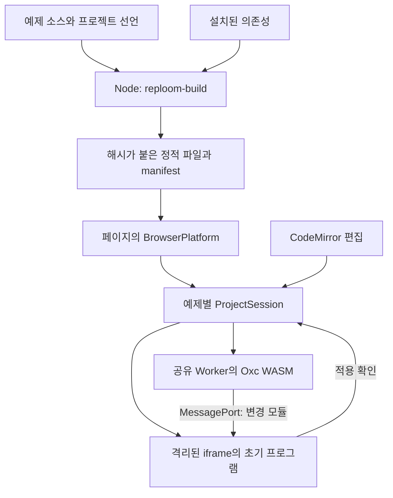

# 블로그의 코드 예제

편집 가능한 예제는 [Reploom](https://github.com/yongsk0066/reploom)의 패키지를 사용한다. 운영 빌드는 발행된 한국어·영어·일본어 글에서 사용하는 프로젝트만 준비한다. 현재는 `useEffectEvent` 예제 아홉 개다. 개발 서버의 `/design/playground/`에서는 `moveBefore` 초안과 React·DOM·계산 Worker 예제도 편집할 수 있다.

## 설치와 실행

```sh
node scripts/reploom/bootstrap.mjs
pnpm install --frozen-lockfile
pnpm dev
```

`scripts/reploom/release.json`에 고정한 커밋을 HTTPS로 받아 `.reploom/source`에서 빌드하고, 세 패키지를 `.reploom/packages`에 준비한다. 설치한 패키지는 잠금 파일의 무결성 검사도 받는다. `.reploom`은 Git에서 제외되며, CI도 같은 순서로 준비한다.

현재 통신 규약은 프로토콜 9다. 갱신할 때는 release의 커밋·패키지 버전·프로토콜을 확인하고 bootstrap을 실행한 다음 `pnpm install --no-frozen-lockfile`로 아카이브 무결성 값을 갱신한다. `pnpm build`로 prepared 자산을 다시 만들고 검증한 뒤 잠금 파일과 함께 반영한다. 생성기는 프로토콜이 맞지 않으면 실패하며, 배포는 새 호스트 코드와 `public/reploom` 전체를 같은 빌드에서 가져간다.

글은 `src/components/article/reploom/Example.astro`에 프로젝트 ID, 제목, 언어만 전달한다. 예제 원문은 `_examples`에 두고 `src/playground/projects.mjs`에서 파일·진입점·정확한 의존성 버전을 선언한다. 이 목록은 Node 빌드 입력이다. Astro는 빌드 때 첫 파일의 문법 강조를 HTML로 출력한다. 브라우저에서는 글에 고정한 manifest를 사용해 예제가 화면에 가까워지면 초기 프로그램과 의존성을 같은 출처에서 가져오고, 편집 시 CodeMirror와 Oxc를 불러온다.

## 실행 흐름



글의 HTML에 첫 파일의 코드와 색상이 포함된다. `client:visible`이 예제 가까이에서 React UI를 마운트하면 브라우저가 미리 컴파일한 프로그램을 격리된 iframe에서 실행한다. 독자가 편집을 선택하면 CodeMirror가 읽기 화면을 이어받고, 소스 변경 시 컴파일러 Worker와 WASM이 로드된다.

편집 시 `ProjectSession`이 소스 revision과 변경 내용을 관리하고, Worker의 Oxc가 변경된 모듈을 컴파일한다. 실행 코드는 전용 MessagePort로 미리보기에 전달한다. 미리보기의 적용 확인을 다음 변경의 기준으로 삼고, 기준이 어긋나면 전체 프로그램으로 다시 동기화한다. React Fast Refresh가 호환되는 컴포넌트 편집의 상태를 유지하고, 컴파일 실패 시 마지막으로 동작한 미리보기를 남긴다.

같은 문서의 Astro islands는 `platform.ts`의 사용권을 통해 compiler와 검증된 파일 캐시를 공유한다. 각 UI는 자신의 session과 preview를 정리한다. 마지막 사용권이 반환되면 하위 session의 정리가 끝난 뒤 platform을 폐기한다. 패키지가 실행·편집 로직을 소유하고, 블로그는 수명 연결·번역·스타일만 담당한다.

플랫폼은 소스와 프로그램 JSON을 한 번 파싱한 불변 객체로 공유한다. 실행 스크립트는 Blob으로 미리보기에 전달하고, 실행 영역에서 디코딩한다. 여러 스크립트를 병렬로 디코딩해도 실행은 선언 순서를 따른다. 각 예제의 변경 revision과 React 상태는 해당 session과 미리보기에 속한다.

React와 DOM 사용자 코드는 iframe의 Window 이벤트 루프에서 실행된다. 컴파일 작업은 Worker로 분리되며, 긴 사용자 루프에는 협조적 실행 예산이 적용된다. DOM이 필요 없는 계산은 별도 Worker와 종료 watchdog을 사용한다. iframe의 출처 격리와 CSP, CPU 실행 예산은 서로 다른 경계다. Hook 구조 변경이나 호환되지 않는 export 변경은 상태를 초기화할 수 있다.

## 배포와 검증

`pnpm build`가 `public/reploom`을 준비한 뒤 Astro를 빌드한다. 배포 디렉터리는 이번 manifest와 여기에 등재된 자산만 담는다. Cloudflare Worker는 WASM과 모듈의 MIME 타입을 지정하고, 해시가 붙은 파일은 장기 캐시하며 manifest는 재검증한다. 실행 중 패키지 CDN이나 원격 컴파일 서비스는 필요하지 않다.

```sh
pnpm check:playground
pnpm test:playground:modules
pnpm build
pnpm test:playground
```

위 검증 명령은 로컬에서 실행한다. 블로그 배포 파이프라인은 고정 패키지 준비·설치·빌드·배포를 수행한다.

브라우저 검증은 Chromium·Firefox·WebKit에서 정적 빌드와 로컬 개발 서버를 각각 연다. 정적 글에서는 외부 요청을 차단하고 첫 코드의 색상, 언어별 편집·상태 유지·오류 복구, 컴파일러 공유, 모바일 너비와 비공개 경로의 404 응답을 확인한다. 개발 서버에서는 Dialog·Portal과 React·DOM·계산 Worker 예제를 검증한다. 전체 블로그의 외부 임베드·분석 도구 요청은 실행기의 의존성과 별개다.
